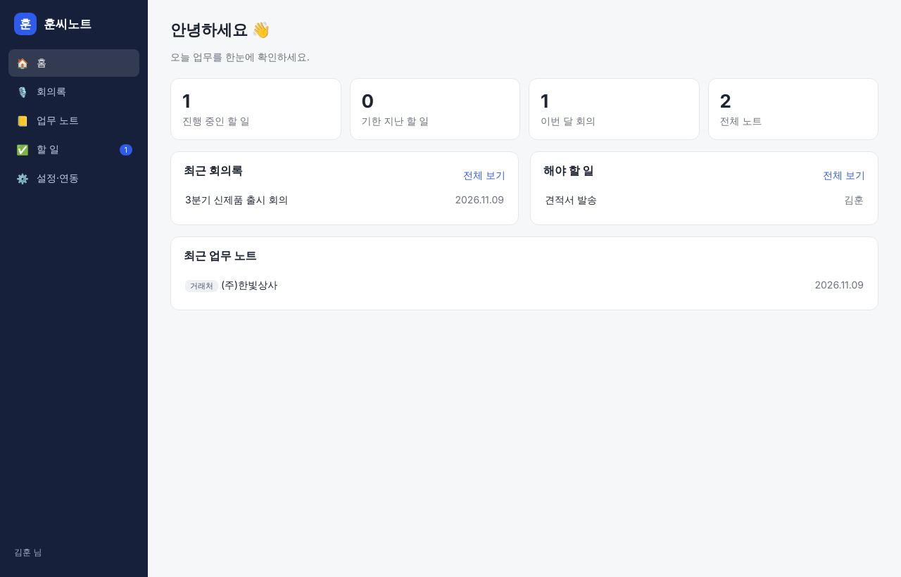
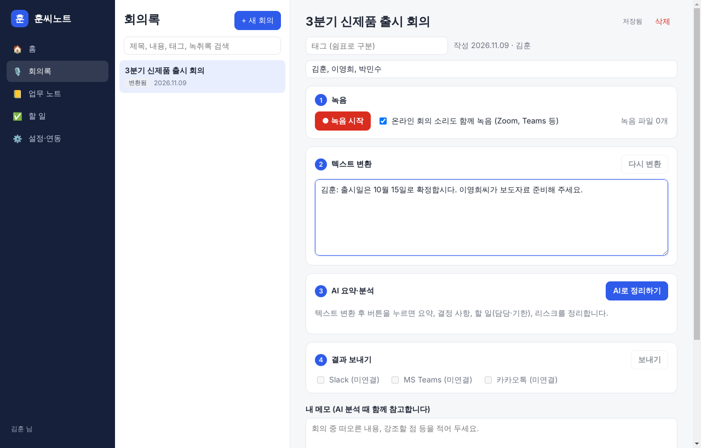
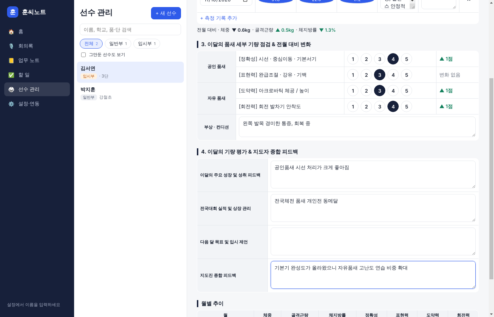

# 강철노트

팀 업무를 한곳에서 정리하는 PC 프로그램 (Windows · Mac)

- **회의록**: 녹음 → 텍스트 변환 → AI 요약·분석 → Slack / Teams / 카카오톡으로 결과 전송
- **업무 노트**: 메모, 거래처, 프로젝트 노트 (태그 · 검색)
- **할 일**: 회의에서 나온 할 일이 담당자·기한과 함께 자동 등록
- **선수 관리**: 일반부·입시부 등 구분별 선수 프로필, 월별 성장기록부(인바디·체력, 품새 기량 1~5점, 지도자 피드백), 전월 대비 변화 자동 계산, 기록부 PDF 저장
- **홈**: 진행 중·기한 지난 할 일, 최근 회의를 한눈에





## 실행 방법

[Node.js](https://nodejs.org) 20 이상을 설치한 뒤:

```bash
npm install
npm run dev        # 개발 모드로 실행
npm run dist:win   # Windows 설치 파일 만들기 (release 폴더)
npm run dist:mac   # Mac 설치 파일 만들기 (Mac에서 실행)
```

GitHub의 main 에 코드가 올라갈 때마다 Windows·Mac 설치 파일이 자동으로 만들어져
**Releases** 페이지에 올라갑니다 (`.github/workflows/build.yml`). 릴리스 이름은 `package.json` 의 `version` 을 따릅니다.

> 설치 파일은 아직 코드 서명이 없어서 처음 실행할 때 경고가 뜹니다.
> - Windows: "Windows의 PC 보호" → **추가 정보** → **실행**
> - Mac: 앱을 **우클릭 → 열기** (또는 시스템 설정 → 개인정보 보호 및 보안 → "확인 없이 열기")

## 처음 설정 (설정·연동 메뉴)

| 항목 | 용도 | 받는 곳 |
|---|---|---|
| Claude API 키 | 회의 요약·분석 | console.anthropic.com |
| OpenAI API 키 | 녹음 → 텍스트 변환 | platform.openai.com |
| AI 모델 선택 | 정확도와 비용 조절 (Opus / Sonnet / Haiku, 음성 인식 모델) | 설정 화면 |
| Slack 웹훅 | 채널로 결과 전송 | Slack 앱 → Incoming Webhooks |
| Teams 웹훅 | 채널로 결과 전송 | Teams 채널 → 워크플로 → "웹후크 요청이 수신되면 채널에 게시" |
| 카카오 액세스 토큰 | 카카오톡 나에게 보내기 | developers.kakao.com (카카오톡 메시지 동의 항목) |

각 연동에 "AI 정리가 끝나면 자동 전송"을 켜 두면 분석이 끝나자마자 바로 보내집니다.

## 자동 업데이트

- **Windows**: 새 버전이 나오면 뒤에서 받아 두고, 위쪽 알림의 **지금 재시작**을 누르거나 프로그램을 끌 때 설치됩니다.
- **Mac**: 코드 서명이 없어 자동 설치는 안 되고, 새 버전 알림과 다운로드 페이지 열기를 제공합니다.
- 설정·연동 맨 위에서 현재 버전 확인과 **업데이트 확인**을 할 수 있습니다.

## 팀 공유 서버 (여러 PC 실시간 동기화)

1. Supabase 프로젝트를 만들고 SQL Editor 에서 `supabase/schema.sql` 을 실행합니다.
2. Authentication → Sign In / Providers 에서 **Allow new users to sign up** 을 끕니다.
3. Authentication → Users → Add user 로 팀원 계정을 만듭니다 (**Auto Confirm User** 체크).
4. 각 PC의 강철노트 **설정·연동 → 팀 공유 서버**에 Project URL 과 publishable 키를 넣고 로그인합니다.

- 노트·회의록·할 일·선수 기록이 공유됩니다. API 키 등 설정과 녹음 파일은 PC마다 따로입니다.
- 인터넷이 끊겨도 PC에 먼저 저장되고, 다시 연결되면 자동으로 올라갑니다.
- 같은 항목을 두 PC에서 동시에 고치면 나중에 고친 내용이 남습니다.

## 구조

```
src/
  main/            Electron 메인 프로세스
    index.ts       창, IPC, 시스템 소리 캡처
    store.ts       저장소 (지금: PC 안 JSON, 다음: 공유 서버) · 키 암호화
    services/
      transcribe.ts  OpenAI 음성 인식 (10분 단위 파일)
      analyze.ts     Claude 회의 분석 (구조화된 JSON 결과)
      send.ts        Slack / Teams / 카카오톡 전송
  preload/         화면 ↔ 메인 연결 (window.api)
  renderer/        React 화면 (홈, 회의록, 업무 노트, 할 일, 설정)
  shared/types.ts  공통 데이터 형식
```

## 로드맵

- [x] 1단계: 업무 노트 · 할 일 · 홈
- [x] 2단계: 녹음 → 텍스트 변환 → AI 요약·분석
- [x] 3단계: Slack / Teams / 카카오톡(나에게) 전송
- [x] 선수 관리 · 월별 성장기록부 · PDF 저장
- [x] 4단계: 팀 공유 서버(Supabase) · 로그인 · 실시간 동기화 · 오프라인 대기열
- [ ] 카카오 알림톡(팀원에게 전송), 화자 구분, 기존 녹음 파일 불러오기, 일정 연동
